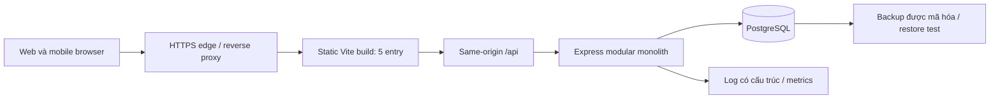

# JobTrack — thiết kế hệ thống áp dụng cho năm giao diện

## 1. Điểm xuất phát và phạm vi

Nguồn sự thật là `Tài liệu/03-system-analysis (1).docx`, Proposal, khảo sát và các quyết định nghiệp vụ trong `PLAN.md`. Lần này đã đọc lại văn bản DOCX; `source-text.txt` là bản trích để đối chiếu, không chứng nhận các hình nhúng trong Word.

Hiện có năm entry React/Vite trong `apps/experiences`, shared domain/repository/hook trong `packages/jobtrack-core`. Demo ghi localStorage, có unit test và build frontend. `apps/experiences/API.md` mới là biên kết nối; chưa có `apps/api`, PostgreSQL, phiên máy chủ hay hạ tầng production. `apps/web` là giao diện vòng trước.

MVP giữ: auth; CRUD application; bảy trạng thái; tìm/lọc/sắp xếp; ghi chú; một next action/deadline; nhiều interview với ba trạng thái và múi giờ; duplicate/reapply; dashboard bốn chỉ số; ownership. Không bổ sung AI, CV upload, admin, history, calendar/email sync, notification, đa task hoặc thanh toán.

## 2. Kiến trúc đích



Đây là kiến trúc đề xuất, không phải topology đã triển khai. Sơ đồ Draw.io có phiên bản hiện trạng và đích riêng để tránh nhầm.

Chọn **modular monolith**: Auth, Applications, Interviews và Dashboard có ranh giới module nhưng cùng tiến trình/deploy và cùng DB. Tạo interview cần cập nhật application trong một transaction; một DB giúp giữ bất biến này dễ kiểm chứng. Microservices sẽ thêm giao tiếp mạng và đồng bộ dữ liệu khi chưa có tải đo được hoặc nhóm vận hành độc lập. Đây là quyết định riêng cho JobTrack, dựa trên so sánh layered/hexagonal/microservices trong nguồn, không phải yêu cầu của repo tham khảo.

HTTPS edge phục vụ file tĩnh và chuyển `/api` đến API private. Năm frontend có thể cùng một build như hiện tại; account/cookie dùng chung origin và dữ liệu cùng owner. Không route theo phong cách giao diện vào năm database. Static hash assets có cache lâu; HTML ngắn hạn/revalidate. Dữ liệu riêng tư và phản hồi auth dùng `Cache-Control: no-store`; service worker/CDN không lưu API.

## 3. Ranh giới module và cấu trúc mã nguồn

```text
apps/experiences/                 5 UI độc lập, giữ nguyên topology
apps/api/src/http/               route, input parsing, auth/origin/error middleware
apps/api/src/modules/auth/       credentials, cookie/JWT, session revocation
apps/api/src/modules/applications/ CRUD, identity, duplicate/reapply
apps/api/src/modules/interviews/ lịch, ownership qua application, atomic status sync
apps/api/src/modules/dashboard/  tổng hợp nhất quán theo owner và một asOf
apps/api/src/db/                 pool, withTransaction, query timeouts
packages/contracts/             DTO/schema/runtime enums, không phụ thuộc React
packages/jobtrack-core/          domain thuần + frontend data adapter/hook
db/migrations/                  migration đã được kiểm thử, được tạo ở bước triển khai
docs/system-design/             thiết kế đích và bằng chứng
```

Đường dẫn backend/contracts/migration ở trên là **cấu trúc sẽ tạo**, không phải thư mục runtime đã tồn tại. `schema.sql` nằm trong docs để không bị hiểu nhầm là migration đã apply.

Controller nhận HTTP và trả DTO; Service thực thi nghiệp vụ, clock và transaction; Repository chỉ SQL tham số hóa trên client được truyền vào. Service không gọi `fetch`, localStorage hay React. Không import `packages/jobtrack-core/src/index.ts` vào backend vì file đó chứa hook/browser API; tách domain/normalization/time validation thuần sang contracts/domain trước.

Interviews gọi application repository trong cùng transaction context, không gọi HTTP Applications. Dashboard đọc cùng database, không gọi bốn module qua mạng. Auth cấp `userId/sessionId` từ token đã xác minh; body/query không được quyết định owner. Kiểu repository phải buộc truyền owner, ví dụ `findOwned(tx,userId,id)`.

## 4. Quy mô giả định và mục tiêu đo

Các số sau là **kịch bản thiết kế**, chưa phải traffic thực tế: 10.000 tài khoản, 1.000 DAU, 100 hồ sơ/tài khoản trung bình, 0,4 interview/hồ sơ; không phải giới hạn sản phẩm. Tương ứng khoảng 1 triệu application và 400.000 interview.

Giả định mỗi DAU có 120 lượt đọc và 30 lượt ghi/ngày: trung bình khoảng 1,39 read/s và 0,35 write/s; dùng hệ số đỉnh 30 lần cho bài test khoảng 42 read/s và 11 write/s. Hệ số và hành vi cần thay bằng số đo. Nếu mỗi application trung bình 2 KiB và interview 1 KiB: dữ liệu nội dung khoảng 2,3 GiB; index/overhead giả định nhân đôi thành khoảng 4,6 GiB, chưa tính bloat/backup/log hoặc ghi chú dài. Dự trù lưu trữ phải đo sau seed, không dùng phép tính này để mua máy chủ.

Mục tiêu ban đầu, phải benchmark trước khi cam kết: API p95 đọc <300 ms, ghi <500 ms trong kịch bản trên; lỗi 5xx <1%; khả dụng 99,5%/tháng. RPO 24 giờ, RTO 4 giờ cho MVP một DB, chỉ được công bố sau restore drill. Đo từ phía API; thời gian render/mạng của mobile là chỉ số riêng.

## 5. API và tiến hóa adapter

Chọn REST JSON và same-origin cookie. Contract đích trong `openapi.json`; không cần GraphQL, gRPC, WebSocket hoặc API gateway chuyên dụng cho nghiệp vụ CRUD này. Reverse proxy không thay authorization ở API.

Giữ tên trường UI `url`, `jobCode`, `at` để giảm đổi năm app; backend ánh xạ sang snake_case ở DB. DTO dùng chuỗi rỗng cho trường text/date tùy chọn để tương thích form hiện tại; deadline trên wire là ISO instant hoặc `null`. `appliedAt` vẫn date-only. Thời gian interview là instant có offset rõ ràng, trả UTC và giữ IANA gốc.

`GET /applications` tiếp tục trả mảng đầy đủ của owner trong pha kết nối đầu tiên, để các vùng status/lịch/tổng quan không vô tình tính trên một trang dữ liệu. Chưa đặt hard cap làm mất hồ sơ. Đo người dùng có nhiều hồ sơ và payload; chuyển sang `/applications/page` có keyset `(created_at,id)` và metadata tổng theo owner khi UI hỗ trợ tải trang. Endpoint mới không được âm thầm thay mảng thành envelope. GET legacy vẫn có query lọc/sort; dashboard luôn dùng toàn bộ owner, không dùng các hàng đang lọc.

Tất cả mutation application/interview dùng phiên bản aggregate application: `If-Match: "app:<uuid>:v<version>"`; DB tăng version khi sửa hồ sơ hoặc bất kỳ interview. 412 khi bản đã đổi; UI giữ draft, tải bản hiện tại rồi yêu cầu người dùng quyết định. Không tự retry stale draft đè dữ liệu. POST create có Idempotency-Key để retry sau timeout không tạo thêm hồ sơ/lịch. Chi tiết ở DATA-MODEL.

Những header/DTO này chưa được adapter hiện tại gửi; phải nâng shared adapter và kiểm tra cả năm UI trong cùng slice trước khi bật `VITE_DATA_MODE=api`. Chế độ demo không đổi trong công việc thiết kế này.

## 6. Xác thực, phiên và ownership

Giữ yêu cầu JWT trong cookie `HttpOnly; SameSite=Lax; Secure` trên HTTPS, `Path=/`, không có Domain rộng. Đề xuất tên production `__Host-jobtrack`; local HTTP dùng tên riêng, không bỏ Secure của production. JWT ký với thuật toán allowlist, `iss`, `aud`, `sub`, `sid`, `iat`, `exp`; không đặt email/password/notes trong JWT. Khóa do secret manager/env ngoài source cung cấp, rotation có kid allowlist.

Đề xuất TTL 8 giờ không refresh token trong MVP. Thêm bảng sessions để kiểm tra còn hiệu lực trên mỗi request và revoke sid khi logout: id=sid, user_id=sub, revoked_at IS NULL, expires_at>now; JWT exp cũng phải còn hạn. Vì vậy đây là JWT có trạng thái thu hồi ở DB, không quảng cáo stateless hoàn toàn. Logout phải xóa đúng thuộc tính cookie và revoke server session; mất mạng không được giả báo thành công. Nếu session DB không truy cập được, trả 503, không bỏ qua kiểm tra.

Mật khẩu 15–64 ký tự, không trim/normalize/cắt; mật khẩu Unicode cần thống nhất cách đếm code point giữa UI/server. Argon2id theo cấu hình được benchmark; mức tham chiếu OWASP đã kiểm tra là ít nhất 19 MiB, 2 iterations, parallelism 1, không đặt giá trị này thành hằng số không đo tải. Đăng nhập sai dùng thông báo chung và dummy verification khi email không tồn tại. Chặn password trong log và telemetry.

Origin allowlist so khớp scheme/host/port chính xác cho POST/PATCH/DELETE, gồm register/login/logout; từ chối missing/null Origin cho browser mutation. CORS mặc định tắt do same-origin. Không chấp nhận `*` với credentials. Read không tạo tác dụng phụ. Cookie không thay CSRF/Origin validation.

Mọi query bắt buộc `user_id = session.sub`; interview phải join qua application có cùng owner. Không có record/khác owner cùng trả 404. Validate UUID và allowlist trường/sort; unknown write properties bị từ chối. Link tuyển dụng/meeting chỉ hiển thị HTTP(S) phù hợp; backend không tự fetch link người dùng nhập.

Rate limit khởi điểm để đo: login theo IP + account fingerprint; tổng request theo user; giới hạn body 64 KiB. Một instance có limiter bộ nhớ với giới hạn rõ; khi có hai API instance phải dùng shared store hoặc limiter ở edge trước khi mở rộng, không nhân đôi quota vô ý. Response 429 có Retry-After. Giá trị limit cụ thể phải được kiểm thử NAT, reset và abuse; không có yêu cầu cài Redis ngay.

### Mâu thuẫn đã phát hiện khi đọc lại tài liệu

FR-01/UC-01 trong DOCX yêu cầu đăng ký thành công **tạo phiên và mở ứng dụng**; API.md/frontend vòng trước lại bắt đăng nhập lần nữa. Thiết kế đích ưu tiên tài liệu gốc: register 201 + cookie + UserSession. Adapter và năm nhánh register cần sửa theo kế hoạch, chưa được tuyên bố đã sửa.

FR-03 yêu cầu kiểm tra phiên: thêm GET `/auth/me`, không suy luận có session chỉ vì GET danh sách thành công. Proposal nói interview “đầu tiên”, UC-11/BR-06 nói tạo interview; chốt theo phân tích chi tiết và hành vi core: mỗi lần tạo interview áp dụng status sync, sửa/xóa không suy ra history. Đây là quyết định được ghi rõ để đưa vào test.

## 7. Vận hành và độ bền

API private, DB không public; chỉ edge nhận Internet. Một API instance và một PostgreSQL là cấu hình MVP đề xuất, có điểm lỗi đơn được ghi nhận. DB dùng pool nhỏ theo ngân sách connection; tổng `instances × pool.max + migration/admin reserve` phải nhỏ hơn DB max_connections. Khởi điểm pool 10, statement timeout 5 giây, lock timeout 2 giây, request budget 10 giây là tham số cần load test, không phải kết quả đã đo. Retry deadlock/serialization có giới hạn cho transaction an toàn; không retry lỗi validation/duplicate/stale version.

Liveness kiểm tra tiến trình; readiness query DB ngắn và migration version. Readiness fail khi DB hỏng; không dùng liveness reset liên tục chỉ vì DB ngắt. SIGTERM: ngừng nhận request, hoàn tất request trong grace period, đóng pool. Log JSON gồm requestId, route template, status, duration và error code; không ghi body/token/email/URL đầy đủ/ghi chú. Dashboard vận hành theo dõi latency, errors, connection saturation, lock wait, duplicate conflict, 412, 429, storage và backup age. Alert là cấu hình vận hành sẽ triển khai, không gửi tin nhắn ở lượt này.

Backup mỗi ngày có mã hóa, retention dự kiến 7 ngày/4 tuần, tách nơi giữ khỏi DB chính và hạn chế quyền. Kiểm tra restore vào DB tách biệt trước phát hành và định kỳ. Sau restore phải kiểm tra counts, FK, duplicate invariants, version và login/revocation; dữ liệu phiên có thể cần revoke toàn bộ. Muốn RPO thấp hơn phải chọn PITR/WAL theo host và diễn tập, không mặc định daily dump là không mất dữ liệu.

## 8. CI/CD và rollout

CI frontend + kiểm tra artifact thiết kế được thêm vào repository, không auto deploy. Backend CI tương lai phải chạy migration và integration với PostgreSQL thật; mock không chứng minh lock/unique/cascade. Release tạo artifact immutable với commit id; migration chạy một lần, không để mọi replica tự migrate lúc boot. Dùng expand/contract khi đổi DTO/schema. Đầu tiên staging → smoke cả năm app qua API → phát hành có rollback về artifact trước; rollback schema có dữ liệu cần kế hoạch riêng, không chạy drop/reset tự động.

## 9. Khi nào mới mở rộng

| Dấu hiệu đo được | Hành động trước | Chỉ sau đó cân nhắc |
|---|---|---|
| List chậm/payload lớn | query plan, owner index, keyset + UI tải trang | full-text/trigram nếu substring có bottleneck |
| Dashboard DB chậm | EXPLAIN ANALYZE, aggregate đúng, pool | cache per-owner có invalidation/version; không cache sai owner |
| API CPU p95 vượt mục tiêu | profile, query/bcrypt/Argon2 concurrency, scale dọc | hai replica + LB và limiter dùng chung |
| DB read saturation | index và giảm N+1, đo lock | read replica cho dữ liệu chấp nhận stale, ghi/ownership vẫn primary |
| Tác vụ nặng mới thực sự có yêu cầu | tách job boundary và retry/idempotency | queue/worker; notification/import chưa thuộc MVP |
| Module có team/SLO/deploy riêng | đo coupling và transaction boundary | tách service sau khi có lợi ích vận hành rõ |

Không đưa Kafka, Kubernetes, Redis, Elasticsearch, sharding hay multi-region vào đường chạy MVP chỉ vì repo có bài về chúng. Kiến thức mở rộng được giữ trong reference map, không biến thành dependency của dự án.

## Nguồn kỹ thuật đã đối chiếu

[ByteByteGo architecture patterns](https://github.com/ByteByteGoHq/system-design-101/blob/b28380a4710c5ec9638ec037d4168e288f334cba/data/guides/6-software-architectural-patterns-you-must-know.md), [API design](https://github.com/ByteByteGoHq/system-design-101/blob/b28380a4710c5ec9638ec037d4168e288f334cba/data/guides/8-tips-for-efficient-api-design.md), [production components](https://github.com/ByteByteGoHq/system-design-101/blob/b28380a4710c5ec9638ec037d4168e288f334cba/data/guides/10-essential-components-of-a-production-web-application.md). Cách áp dụng và trade-off ở trên là thiết kế mới cho JobTrack.

Kiểm tra chi tiết triển khai với [PostgreSQL partial indexes](https://www.postgresql.org/docs/18/indexes-partial.html), [row locking](https://www.postgresql.org/docs/18/explicit-locking.html), [date/time types](https://www.postgresql.org/docs/18/datatype-datetime.html), [OWASP password storage](https://cheatsheetseries.owasp.org/cheatsheets/Password_Storage_Cheat_Sheet.html) và [OpenAPI 3.1.1](https://spec.openapis.org/oas/v3.1.1.html). Các trang kỹ thuật chung của ByteByteGo không thay đặc tả PostgreSQL hoặc tiêu chuẩn auth.
