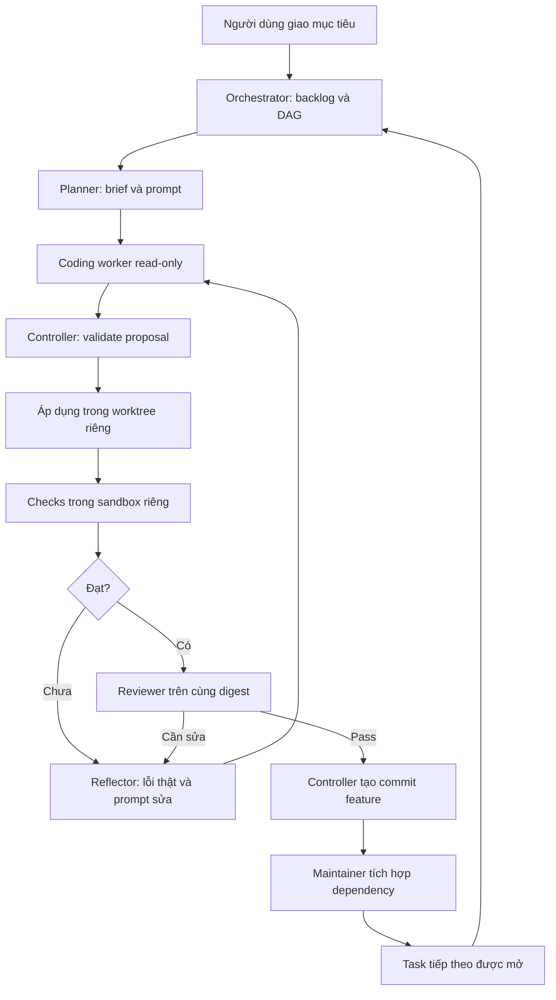

# Kiến trúc đích cho development agents

Đây là thiết kế cần triển khai/kiểm chứng, không phải mô tả mọi khả năng đã hoạt động. Tái sử dụng `tools/agent-control` và tách module khi có hành vi/adapter thực sự khác; không thêm framework hoặc microservice chỉ để có sơ đồ.

## Hai loại AI cần tách quyền

Development agents sửa source trong task/worktree được giao. AI của sản phẩm JobTrack dùng MCP/n8n để thao tác dữ liệu tài khoản. Không cấp quyền Git/shell cho chatbot sản phẩm; không cấp production DB hoặc tài khoản người dùng cho coding workers. Hai hệ thống có thể chia sẻ schema quan sát đã làm sạch, không chia sẻ credential hay quyền.

## Vai trò

| Vai trò | Nhận/trả | Quyền |
| --- | --- | --- |
| Người dùng/Product owner | Mục tiêu, ưu tiên, ngân sách và tiêu chí | Chốt scope, exception và phát hành |
| Orchestrator | Backlog/DAG/state/evidence → task ready và phân công | Chỉ gọi interface điều phối; không phát sinh arbitrary shell hoặc tự đổi policy |
| Planner | Source snapshot/brief → kế hoạch và prompt coding | Read-only, không mở rộng scope/lane |
| Coding worker | Task đã khóa → proposal có prior hash | Read-only; đề xuất thay đổi, không tự ghi/commit |
| Check runner | Digest + check IDs → exit codes/evidence | Sandbox riêng, chỉ target fixture được cấp; test code cũng được xem là untrusted |
| Reflector | Yêu cầu/diff/log thật → prompt sửa | Read-only; không sửa expectation/policy để tạo PASS |
| Reviewer | Task + diff + checks cùng digest → findings/verdict | Read-only, run độc lập với coder; không dùng self-review làm gate |
| Controller/patch broker | Task capability + proposal → patch/feature commit | Thành phần duy nhất ghi code/Git trong managed workflow; policy do maintainer quản trị |
| Maintainer/Integrator | Các feature commits → integration candidate | Tích hợp dependency, config/migration/CI và release gates; không giao quyền này cho worker |

Agent làm việc theo role và run ID; không giả vờ có nhiều reviewer chỉ bằng đổi tên cùng một kết quả. Coding agents mỗi feature có worktree/branch riêng. Reviewer đọc snapshot của feature, không cần một nhánh ghi riêng vì không viết code.

Mọi cạnh cần kiểm task state/lease/digest/capability; LLM không có đường riêng vượt broker. Các bước có side effect phải có idempotency và journal để restart không nhân worktree/commit/run.

## Các module và interface dự kiến

Tên interface dưới đây là thiết kế, chưa phải CLI/API đã được cài. Interface nhỏ phải giấu được việc quản lý lease, hashes, crash và validation khỏi callers.

| Module | Interface cốt lõi | Implementation/invariants |
| --- | --- | --- |
| Task coordinator | submit, nextReady, dispatch, status, stop | DAG hợp lệ, dependencies integrated, WIP1/lane, giới hạn run/budget |
| Workspace manager | reserve, snapshot, finalize | Branch/worktree riêng; base SHA; task ID; feature paths; common Git không lộ cho worker |
| Proposal broker | validateAndApply | Capability server-owned, prior hashes, paths/links, limits, secrets/comments, journal và atomic failure recovery |
| Check executor | verifyDigest | Trusted check catalog/fingerprint; sandbox; env tối thiểu; timeout/child cleanup; evidence hash |
| Review gate | recordVerdict | Reviewer độc lập; check/diff/acceptance cùng digest; thay byte làm mất hiệu lực verdict |
| Delivery module | commitFeature, proposeIntegration | Explicit paths, task/run metadata, không add-all/push; stale base và conflict phải xử lý qua task riêng |
| Experiment registry | record, compare, proposePromotion | Code/data/model/prompt versions, frozen holdout, budget, quality gates và rollback |

Dùng injected worker/check adapters đã có để test qua cùng interface; live adapters phải có canary riêng. Không lấy fixture pass suy ra provider/sandbox chạy được.

## Cách ly theo feature

1. Controller sở hữu repo/worktrees/Git metadata và registry ngoài vùng worker được mount/đọc. Worker chỉ nhận snapshot source cần thiết và task capability không thể tự sửa.
2. Worker thấy source task dưới dạng read-only, cùng dependency contracts đã tích hợp. Không được đọc sibling features, `.git`, control state, dotenv/accounts, private keys hoặc home credential stores. Nếu cần đọc dependency ngoài lane thì controller cấp snapshot tối thiểu theo brief, không cấp toàn ổ đĩa.
3. Worker đề xuất patch; controller kiểm allowed paths theo canonical/real path và file identity, chặn traversal/symlink/junction/hardlink/Windows ADS, protected filenames và stale hashes trước áp dụng.
4. Check runner có vùng scratch riêng và fixture credentials không tái dùng production; ngăn egress và truy cập host secrets. Package scripts/locks/check catalog được pin từ trusted base, không nhận lệnh từ source worker sửa.
5. Mỗi task giữ lease lane + paths + base SHA; toàn batch patch được kiểm trước ghi. Nếu lỗi giữa chừng thì fail-closed, journal và recovery không để tiếp tục với trạng thái nửa áp dụng.

Git worktree chia sẻ common directory. Vì vậy chỉ tạo worktree không đủ bảo mật. Worker không được mount `.git` pointer/common directory; controller giữ worktree thật, có thể cung cấp projection/snapshot đọc cho worker. Nếu công cụ hiện tại vẫn cho worker đọc rộng, phải ghi rõ giới hạn và chưa đạt yêu cầu cách ly mạnh.

Trên Windows, chọn sandbox/identity/ACL hoặc container phù hợp sau canary. Không thay quyền toàn workspace/home, trust wildcard, tắt sandbox hoặc xóa worktree để chữa lỗi. Môi trường kiểm thử và control plane phải được quản trị ngoài quyền worker. Không có tuyên bố chống mọi tác nhân giữ quyền Admin trên host.

## Ba lớp quy tắc

| Lớp | Chức năng | Không thay thế được |
| --- | --- | --- |
| README/AGENTS/brief | Cách làm, giới hạn scope, không comment, checks và escalation | Quyền đọc/ghi của OS |
| Controller/policy code | Structured argv allowlist, path/hash/capability/digest/budget gates | OS/process/network isolation nếu worker có shell trực tiếp |
| OS/sandbox/network | Ngăn đọc/ghi/egress và child process ngoài quyền được cấp | Acceptance nghiệp vụ và review |

Không cho model gửi một chuỗi shell rồi dùng regex tìm vài từ nguy hiểm. Broker nhận operation và argv cấu trúc, chỉ cho phép catalog được pin; shell wrappers, command substitution, pipe, redirection và alternate executables ngoài catalog đều bị từ chối. Terminal/tool khác không qua broker cũng phải bị sandbox chặn.

Các hành động luôn ngoài worker mặc định: push/force push/reset/clean/rebase/destructive checkout, xóa branches/worktrees, thay policy/hooks, install tùy ý, kill process không thuộc task, migrations/restore/load, thao tác production, payment/deploy và gửi tin bên ngoài. Maintainer có task vận hành riêng và target preflight; không mở toàn quyền cho worker để làm các việc đó.

## Git và kết thúc task

Branch mới mặc định `codex/<task-id>-<slug>`, worktree riêng theo task ID. Một task có thể có nhiều proposal vòng sửa nhưng chỉ commit khi checks/review cùng digest đạt. Controller ghi commit chứa task/run/feature metadata, không giả danh tác giả. Mặc định một feature commit review được; không commit từng vòng đang lỗi.

`feature_committed` chưa phải `done`: dependencies chỉ mở khi maintainer tích hợp commit vào base đã kiểm chứng. Không tự cherry-pick/merge conflict bằng ghi đè. Khi conflict hoặc base stale, tạo prompt reconciliation từ diff thật và chạy lại affected checks/review; không reset branch đang có bằng chứng.
