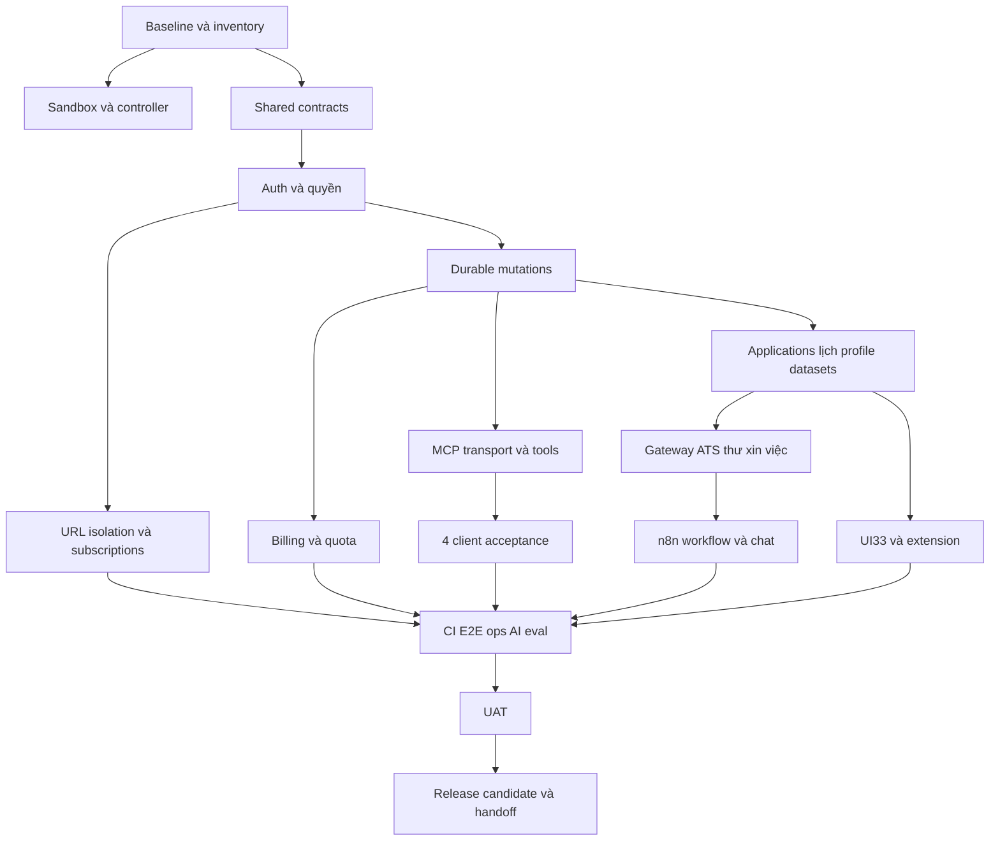

# Plan hoàn thiện JobTrack theo từng bước

Ngày lập: 2026-10-21. Baseline `30db3fd`. Mục tiêu là hoàn tất [scope và22 nhóm nghiệm thu](SCOPE-ACCEPTANCE.md), tận dụng source đã có. Không gán phần trăm toàn dự án chỉ từ số tests hoặc số tasks đóng.

## Bước 1 — tiếp nhận và khóa baseline

Đọc AGENTS, CURRENT-STATE, DECISIONS; kiểm Git/diff/worktrees mà không reset. C00 lập bảng toàn bộ routes/screens/actions/tools/jobs/DB tables → implementation → test → acceptance. Đọc source trước khi dùng master context; kiểm môi trường bằng lệnh read-only, không đọc secrets. Ghi các thay đổi ngoài baseline và tránh ghi đè chúng.

Chốt scope ở SCOPE-ACCEPTANCE; ý tưởng mới thêm backlog tương lai. Trạng thái dùng `planned → investigating → implementing → validating → review → integrated → accepted`; `blocked` phải có nguyên nhân và tác vụ gỡ. Có code không đồng nghĩa accepted. Task điều tra kết luận không cần sửa vẫn cần evidence.

## Bước 2 — chuẩn bị điều phối có kiểm soát

C01 khắc phục sandbox theo quy trình hỗ trợ của môi trường, chạy canary bằng fixture không chứa secrets: worker không ghi workspace/sibling/control/Git, không đọc canary bị cấm, network theo policy, timeout dừng đúng. Nếu chỉ read-only workspace nhưng vẫn đọc ngoài hoặc có network, ghi chính xác giới hạn và chọn container/OS identity tách biệt cho yêu cầu mạnh. Không nới ACL chung/global Git trust hoặc danger-full-access.

C02 xác lập contract mới cho errors, grants/scopes, idempotencyKey, expectedVersion, receipts/runs/conversations và provider envelopes; maintainer review migration cần thiết trước consumers. Không sửa hết modules trong một task. Chưa qua C01 thì không dispatch live worker tự động; vẫn được lập tài liệu/điều tra read-only phù hợp.

## Bước 3 — đóng các rủi ro nền tảng trước mở rộng AI

C03 auth/CSRF/owner/scopes; C04 transaction, idempotency và audit; C09 URL network isolation; C13 billing/activation. Viết regression vào lỗ hổng quan sát được rồi sửa nguyên nhân, không thay lỗi bằng fallback im lặng. Backend API là nơi quyết định user/quyền/giá/quota, không lấy những trường đó từ model, browser hoặc webhook chưa xác thực.

MCP/n8n/extension dùng chung domain services, không tự mở query SQL quyền cao. Idempotency key gắn owner+operation+canonicalpayload: replay cùng payload trả cùng receipt; reuse key khác payload trả conflict; mutation và receipt commit atomically. Không tự đọc latestVersion để che lost update. Purge/privileged profile/payment dùng cùng điều kiện auth người dùng, không hỏi lại mọi thao tác CRUD thường.

## Bước 4 — hoàn thiện từng phần sản phẩm hiện có

C05 applications/lifecycle/import/export, C06 calendar/tasks/dashboard, C07 profile, C08 datasets, C10 subscriptions. Với mỗi phần: kiểm API và DB invariants → UI success/error/conflict → extension/AI consumer nếu có → test ownership/concurrency → review → integrate. Giữ các contract semantics đang đúng như omitted fields khi PATCH, duplicate/reapply, ETag và draft theo user.

C18 thực hiện coverage33 màn hình, đồng bộ typography/spacing/accessibility và hành động thật. C19 extension làm permissions/token/flow thực tế. Tách phần thiết kế main app khỏi5 experiences; không redesign thêm theme hoặc thêm feature mới để thay thế nghiệm thu luồng chính.

## Bước 5 — xây AI/MCP/n8n theo nguồn có thể kiểm chứng

C11 model gateway giới hạn model/server-owned credentials/budget/timeout/cancel và provenance, không phụ thuộc một vendor cụ thể. C12 thay hoặc gắn nhãn rõ heuristic/templates; generation không bịa profile, có eval vi/en, tone và state.

C14 chọn transport MCP tương thích spec/client thực tế và chuẩn hóa bằng SDK khi phù hợp; negotiation/header/error/session/auth được test theo transport. C15 kiểm từng client; remote client không thể gọilocalhost thì cần phương án địa chỉ/TLS/auth và phê duyệt public endpoint riêng. Không tự publish tunnel chứa API tài khoản.

C16 tạo workflow JobTrack riêng trong n8n. Trước tiên thiết kế/export JSON đã redact cho review, sau đó mới import/test theo quyền và môi trường được giao. Workflow mẫu môn toán không sửa. Model gọi API tools với ticket ngắn hạn gắn user/run/scopes, backend xác thực; lịch sử chat phải tách user. Chỉ gateway nhận runtime token; không forward n8n admin API key cho chat webhook.

C17 tích hợp native chat hoặc adapter đáp ứng BFF auth. Thiết kế request/response thực tế của phiên bản n8n được dùng trước khi viết UI; streaming cần đúng parser/protocol, không chỉ đổi label. Fallback nội bộ phải được nhận diện và không tuyên bố mutation đã thành công. Khi workflow gọi tool thành công, UI refresh đúng resources bằng receipt/events.

## Bước 6 — chất lượng, dữ liệu và khả năng vận hành

C20 CI/check commands: Node/version/lockfiles, fixture DB, migration, contract/API/web/MCP/extension/controller. Không gọi tests lên DB chính và không mặc định dựa vào RTK trên runner chưa cài. Giải quyết legacy timeout fixture bằng bằng chứng, không bỏ assertion để xanh.

C21 browser E2E desktop/mobile và cross-user; C22 encrypted backup/restore ở DB riêng cùng migration/rollback; C23 HTTP load/observability/crawler queue. Các lệnh ghi DB/restore/load là maintainer-only và chỉ chạy sau khi xác nhận target riêng, giới hạn tải và dữ liệu mẫu. Không kill cổng app đang dùng.

C24 AI eval: dùng CRISP-DM — mục tiêu → khảo sát dữ liệu → làm sạch/provenance → prompt/model candidates → holdout → release. Dataset tối thiểu30 JD vi/en, nhiều ngành, HTML/SPA/JSON-LD/malformed/injection và profile đủ/thiếu. Tách tuning/holdout; đánh giá correctness/grounding/tools/ownership/cost/latency. Ghi model/provider/prompt/code/data hash. Không tự train/retrain khi chỉ dùng API; drift kích hoạt review/eval lại trước đổi model.

C25 tài liệu/privacy/retention: một nguồn trạng thái có evidence; README cấu hình thực, env.example chỉ placeholder, xóa claims sai trong runbook/client matrix. Secrets scan bao gồm Git history trước chia sẻ remote; legacy defaults không được gọi là đã sạch hoàn toàn. Quy trình revoke token/xóa user/xóa dữ liệu AI rõ ràng.

## Bước 7 — nghiệm thu và release có thể bàn giao

C26 UAT dùng tài khoản/dữ liệu test riêng, user đi các kịch bản A01–A22 trên web/mobile/extension/AI. Phân loại issue; P0/P1 quay task sửa, không ký hoàn tất khi blocker client/provider còn che bằng mock.

C27 freeze release candidate; chạy check phù hợp một lần trên đúng tree đã review, ghi commit/hash/check exit codes/log đã redact. Tạo release notes, rollback guide, danh sách giới hạn và ZIP context mới. Release local là mốc hiện tại; push, public deploy, live payment, email/ứng tuyển ngoài hệ thống là hành động riêng theo yêu cầu người dùng.

## Backlog và phụ thuộc

Task chi tiết, prompt và acceptance nằm ở TASKS.json. Các nhánh chính:

Sơ đồ là nhóm phụ thuộc; TASKS.json là DAG chi tiết. C01 là điều kiện dispatch agents, không phải lý do bypass khi một nhánh chưa chạy được.

## Phân công và chống đụng code

| Lane | Phạm vi | Quy tắc |
| --- | --- | --- |
| contracts | `packages/jobtrack-contract/src` | Tích hợp contract trước API/web/MCP consumers |
| api | `apps/api/src` | Chỉ một worker ghi proposal cho lane tại một thời điểm; server.ts là điểm tranh chấp lớn |
| web | `apps/web/src` | Một task UI ở một thời điểm; không sửa shared contract/manifest/locks |
| extension | `packages/jobtrack-extension` | Source trong lane; package/config/manifest nhạy cảm vẫn maintainer review theo policy |
| mcp | `packages/jobtrack-mcp/src` | Auth/transport API mounts thuộc API task, không viết chéo |
| maintainer | CI, migrations, workflows, ops, docs, policy, scripts/config/locks | Không tự mở quyền controller; task riêng, explicit paths và review |

Tối đa3 workers đồng thời bên cạnh orchestrator khi slot cho phép, nhưng chỉ các lane không giao nhau. Tạo1branch/worktree mỗi task từ base đã tích hợp; mặc định branch `codex/<task-id>-<slug>`. Worktree automation cũ không tái sử dụng nhầm cho task sản phẩm. Task đa lane phải tách các work items liên kết, không cấp rộng `**/*`.

Orchestrator không tuyên bố file READMEs là permission enforcement. Người có quyền OS đầy đủ vẫn có thể bypass; nếu cần chống điều đó phải tách account/container/Git plane trước. Secrets không nằm trong worktrees/prompts/log. Không `git add .`, reset/clean/force push hoặc sửa sibling. Controller commit feature riêng sau checks/reviewer; maintainer quyết định tích hợp.

## Nhịp giao việc và báo cáo

Kanban: giới hạn WIP1/lane, review backlog mỗi mốc G0–G5; nếu dùng Scrum, gom các task ready thành sprint theo năng lực thực, không hứa số ngày khi chưa baseline. Một increment khép kín tốt hơn mở đồng thời mọi màn hình.

Mỗi task báo: yêu cầu/paths/base; việc đã xác minh; patch/commit; commands + exit codes; acceptance còn thiếu; rủi ro và bước tiếp theo. Reflector chỉ viết prompt sửa từ lỗi/log/diff thật. Tối đa3 coder attempts; cùng fingerprint lỗi2 lần thì giữ evidence và chuyển người điều phối xử lý, không tự nới policy.

Hoàn tất toàn dự án khi mọi task cần thiết đã `accepted` hoặc được thay thế bởi bằng chứng tương đương; các exception có quyết định người dùng; G5 đạt. Không tự đánh dấu hoàn tất vì hết context hoặc gần hết ngân sách.
